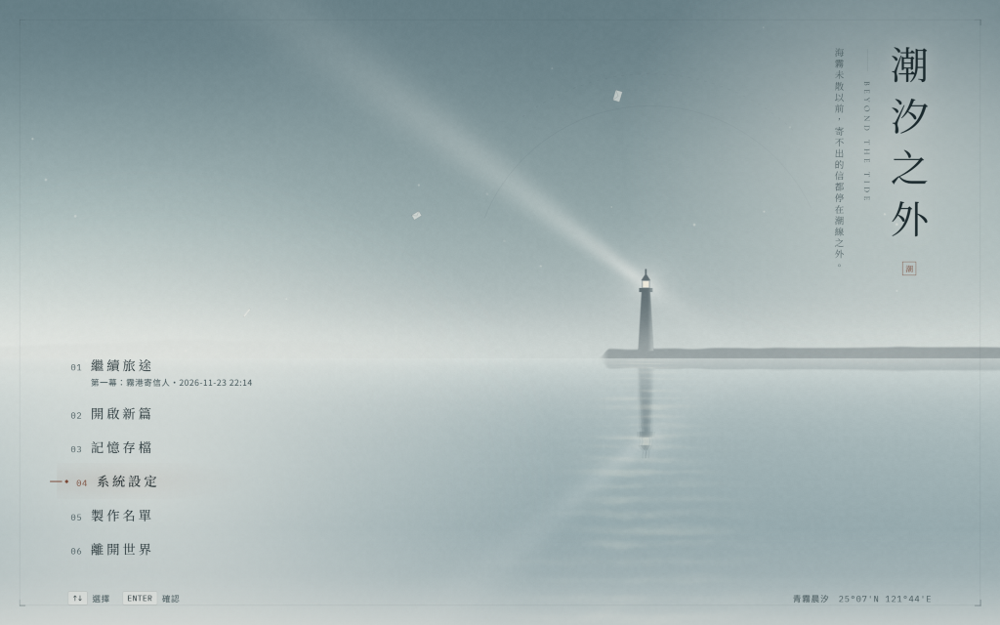
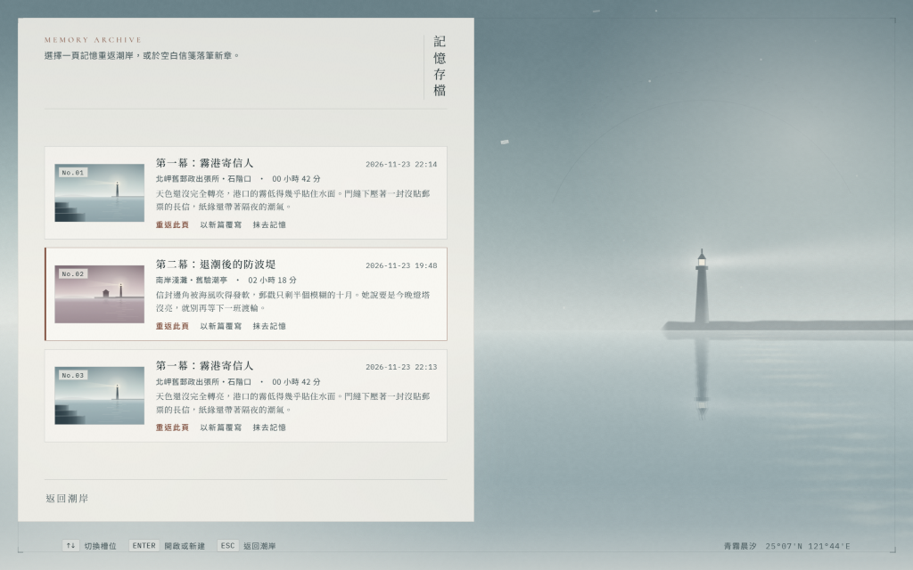
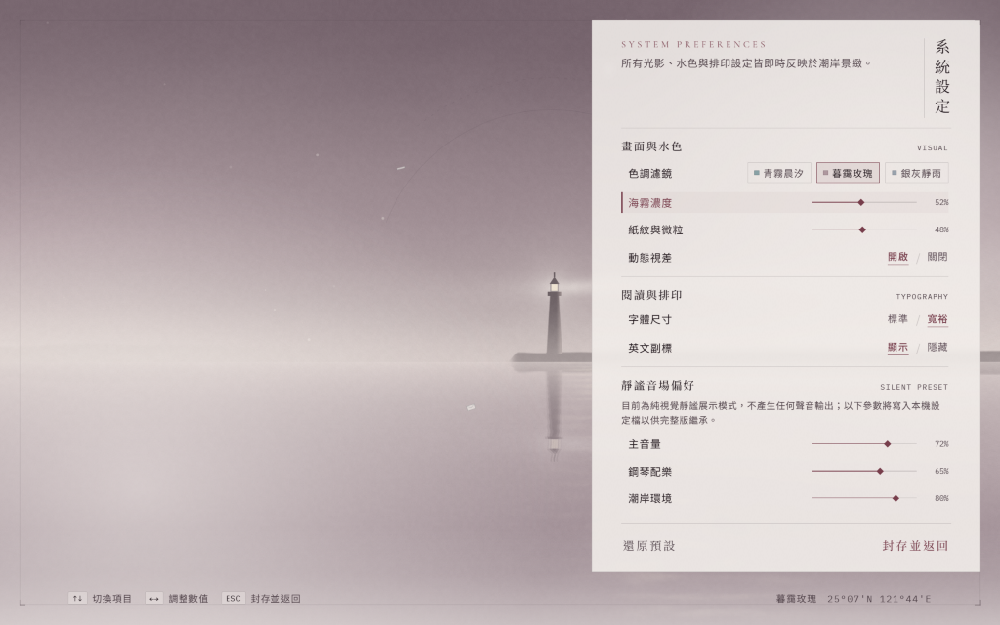

# 潮汐之外 — BEYOND THE TIDE

一款主打「**潮汐書簡與雨霧幻境**」的獨立藝術敘事單機遊戲初始介面原型。以零外部套件依賴之原生 HTML5、WebGL2 GLSL 300 es 濕水彩著色器、Canvas2D 漂浮信箋粒子層與台灣正體繁體直排微排印建構，呈現純視覺靜謐之寬銀幕電影氛圍。

## 線上立即體驗

- **GitHub Pages 直開網址**：https://anguswu529-prog.github.io/beyond-the-tide/
- 無需下載安裝，使用現代瀏覽器（Chrome / Edge / Safari / Firefox）點開即刻操作。

## 實機畫面預覽

### 主標題畫面（青霧晨汐）


### 記憶存檔（左側半透明宣紙摺頁）


### 系統設定（暮靄玫瑰濾鏡・即時海景回饋）


## 核心亮點

- **WebGL2 GLSL 300 es 濕水彩霧海與孤寂燈塔**：低飽和莫蘭迪水彩雲暈、三維慢速旋轉柔和燈塔光柱、3-tap 水彩柔散淺灘倒影、不規則潮水絲光與真實退潮平息演出。
- **三套即時切換文青色調濾鏡**：於系統設定內可即時流暢切換 **青霧晨汐**、**暮靄玫瑰**、**銀灰靜雨**（切換至銀灰靜雨時自動飄落雙層細斜雨絲與水面漣漪）。
- **詩意表層動態**：20 粒緩慢呼吸微光塵、偶爾飄落並於水面化作同心橢圓漣漪的折疊空白信箋、置頂手作棉紙纖維紋理。
- **完整單機遊戲初始介面全流程**：
  - `01 繼續旅途`：自動追蹤最新遊玩記憶章節，無存檔時優雅反灰。
  - `02 開啟新篇`：四句序章詩句逐行過場演出，自動封存進入雙層裱框「第一幕：霧港寄信人」。
  - `03 記憶存檔`：3 組手寫明信片風格圖文存檔槽（含程序化等比水彩小品縮圖、讀取、落筆新章、原位覆寫與抹去二次確認），完整寫入本機 `localStorage`。
  - `04 系統設定`：色調濾鏡、海霧濃度、紙紋與微粒、動態視差、字體尺寸（標準／寬裕 1.12×）、英文副標開關與還原預設，全數即時生效並支援純鍵盤操作。
  - `05 製作名單`：獨立藝術電影節雙語捲動名單與片尾獨立書信彩蛋。
  - `06 離開世界`：無框留白確認與自然退潮告別書頁，可隨時「再次推開門扉」。

## 操作方式（支援滑鼠與完整單機鍵盤導航）

| 畫面 | 按鍵 | 功能 |
| :--- | :--- | :--- |
| 主標題畫面 | `↑` / `↓` / `W` / `S`、`Enter` | 移動水墨游標、確認項目 |
| 記憶存檔 | `↑` / `↓`、`Enter`、`Esc` | 切換存檔槽、開啟或新建、返回潮岸 |
| 系統設定 | `↑` / `↓`、`←` / `→`、`Esc` | 切換設定列、即時切換濾鏡與調整數值、封存返回 |
| 製作名單 | `Space`、`↑` / `↓`、`Esc` | 暫停／繼續、調整捲動速度、返回潮岸 |
| 序章與離開 | `Enter` / `Space`、`←` / `→`、`Esc` | 推進詩句、切換選項、返回潮岸 |

## 本機執行方式

本專案為純靜態原生 ES Modules，零建置工具、零 `node_modules`：

```bash
# 任選一種本地靜態伺服器於專案目錄啟動
npx serve .
# 或使用 Python
python -m http.server 8080
# 或使用 miniserve
miniserve -p 8080 --index index.html .
```

接著於瀏覽器開啟 `http://localhost:8080` 即可。

## 專案結構

```text
beyond-the-tide/
├── index.html               # 16:9 寬銀幕版畫結構與全流程視圖
├── styles/
│   ├── tokens.css           # 三套莫蘭迪 OKLCH 色票與排印變數
│   ├── main.css             # 直排宋體主標、羽化選單游標與棉紙纖維層
│   └── panels.css           # 宣紙側展摺頁、存檔明信片、菱形滑桿與退潮頁
├── src/
│   ├── palettes.js          # 色票參數與台灣正體文學文案
│   ├── shader-sea.js        # WebGL2 GLSL 300 es 濕水彩霧海與燈塔著色器
│   ├── atmosphere-layer.js  # Canvas2D 微光塵、飄落信箋、漣漪與細雨絲
│   ├── save-art.js          # 程序化等比濕水彩縮圖與定場畫框繪製器
│   ├── storage.js           # localStorage 持久化存檔與設定管理
│   ├── ui-views.js          # 存檔、設定、製作名單與序章視圖控制器
│   └── main.js              # 單機狀態機與鍵盤／滑鼠主協調引擎
└── docs/                    # 實機展示預覽圖
```

## 授權條款

本專案採 [MIT License](./LICENSE) 開源釋出。
